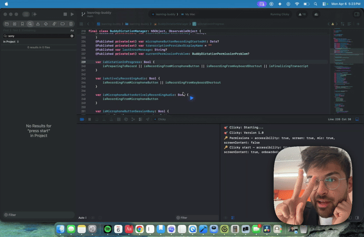

# Teachy

**Teachy** is free & open-source macOS software — a 1:1 teaching companion in your menu bar that sees your screen, points at real UI, and coaches you until something actually runs.

[](LICENSE)
[](https://github.com/VedSoni-dev/teachy/releases/latest)

Born from Farza’s [Clicky](https://www.heyclicky.com/) experiments. This line is Teachy: courses-first, teach-by-doing, open curriculum.



## Free download

Grab the latest build from GitHub Releases (always free — no App Store, no subscription):

**→ [Download Teachy.dmg](https://github.com/VedSoni-dev/teachy/releases/latest/download/Teachy.dmg)**

Or open [Releases](https://github.com/VedSoni-dev/teachy/releases/latest).

### First open (Gatekeeper)

Community builds ship **without** Apple’s paid Developer ID / notarization (keeps Teachy free for maintainers too). macOS may say it “can’t verify” the developer:

1. Drag **Teachy** to Applications  
2. **Right-click** → **Open** → **Open**  
   (or System Settings → Privacy & Security → **Open Anyway**)  
3. Grant Microphone, Screen Recording, Accessibility  

Then run a Teachy proxy (below). Installed apps can **Check for Updates…** under Home → Updates (Sparkle).

> First release shipping soon — until a DMG is posted, build from source with the steps below.

## What it does

- **Learn paths** — goal-based courses (First Win with AI, Use AI to Code, GitHub, and more)
- **Teacher clips** — optional videos beside the cursor, then hands-on coaching
- **Live coaching** — `[POINT:…]` on your real screen, hints, “do it for me,” teach-backs
- **Open curriculum** — course JSON + Mux/HLS videos via `courses/` and Teachy Academy

MIT licensed. Hack on it, ship courses, build companies — go wild.

## Quick start (Claude / Cursor)

```
Clone this repo. Read AGENTS.md (or CLAUDE.md — same file).

I want Teachy running locally on my Mac.

Help me set up the worker proxy with my API keys, then get the Teachy target
building in Xcode (leanring-buddy scheme / PRODUCT_NAME Teachy).
```

## Manual setup (from source)

### Prerequisites

- macOS 14.2+ (ScreenCaptureKit)
- Xcode 15+
- Node.js 18+ (local proxy / Cloudflare Worker)
- API keys: [OpenRouter](https://openrouter.ai) (recommended), [AssemblyAI](https://www.assemblyai.com) optional for streaming STT

### 1. API proxy

The app never ships secrets. All model / STT traffic goes through the Teachy proxy.

```bash
cd worker
cp .env.template .env   # add OPENROUTER_API_KEY (and others as needed)
npm install
npm run local           # http://localhost:8787
npm run harness         # optional smoke test
```

For production Cloudflare:

```bash
cd worker
npx wrangler secret put OPENROUTER_API_KEY
npx wrangler secret put ASSEMBLYAI_API_KEY   # optional
npx wrangler deploy
```

Point the app at your worker via `WorkerBaseURL` in `leanring-buddy/Info.plist`.

### 2. Build & run the Mac app

```bash
open leanring-buddy.xcodeproj
```

1. Select the **leanring-buddy** scheme (legacy project name — the app displays as **Teachy**)
2. Set your Apple Development Team (Signing & Capabilities) so Accessibility / Screen Recording stick across rebuilds
3. **Cmd+R**

Do **not** use `xcodebuild` from the terminal for day-to-day runs — it tends to invalidate TCC permissions.

### 3. Permissions

Grant: Microphone, Screen Recording, Accessibility (and Speech Recognition if using Apple Speech).

| Path | Purpose |
|------|---------|
| `~/.teachy/courses/` | Installed course JSON (falls back to `~/.clicky/courses/`) |
| `~/.teachy/connectors/` | OpenAPI / HTTP connections |

## Releasing updates (maintainers)

See [`scripts/README.md`](scripts/README.md). No Apple paid cert required by default:

```bash
./scripts/release.sh 1.0
```

That ships a free GitHub Release DMG and updates `appcast.xml` so existing installs can update. If you later join the Apple Developer Program: `NOTARIZE=1 ./scripts/release.sh 1.0`.

## Open curriculum

- Authoring: [`courses/README.md`](courses/README.md)
- Academy site: [`academy/`](academy/)

## Architecture (short)

Menu-bar Teachy → notch panel → LessonPlayer / companion voice → Teachy proxy (`worker/`) → OpenRouter + optional AssemblyAI. Mac tools run locally. Full map: **AGENTS.md**.

## Contributing

See [CONTRIBUTING.md](CONTRIBUTING.md) and [CODE_OF_CONDUCT.md](CODE_OF_CONDUCT.md). Security: [SECURITY.md](SECURITY.md).

## License

MIT — [LICENSE](LICENSE). Third-party notices: [NOTICE](NOTICE).

## Credits

Originally created by [Farza](https://x.com/farzatv) as Clicky. Teachy continues that spirit as an open teaching platform for everyone.
